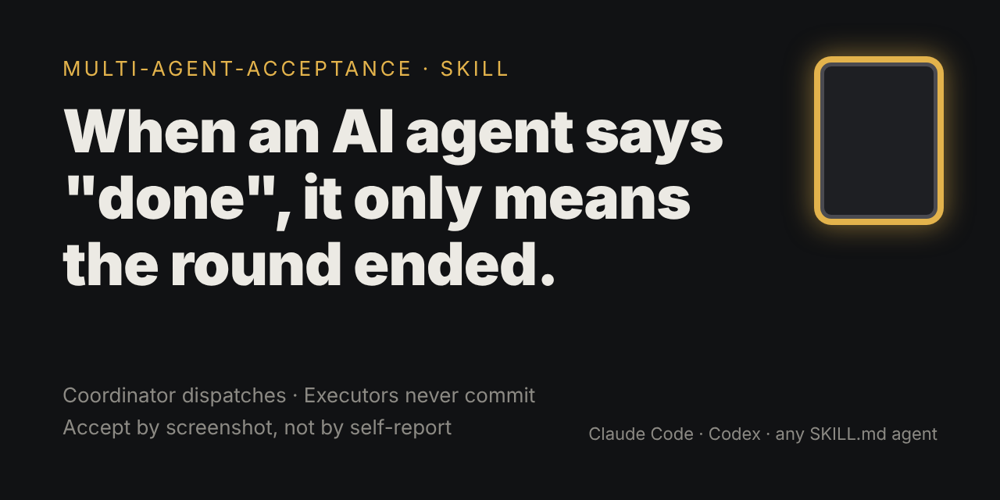
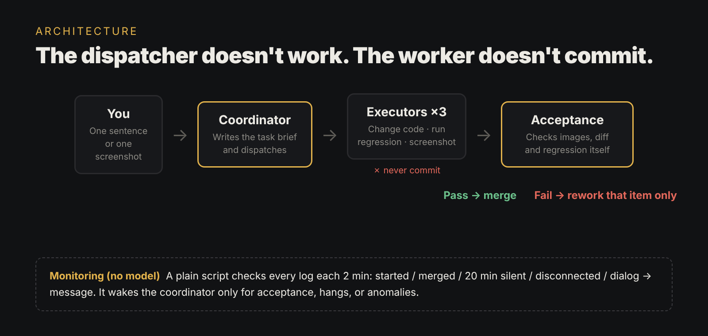
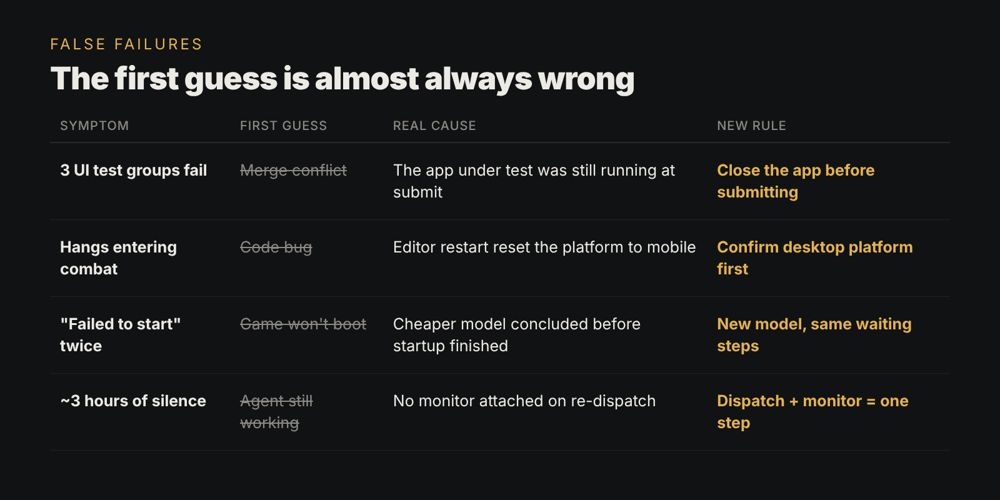

# multi-agent-acceptance



[](LICENSE)


[](https://x.com/Logan790040400)

**When an AI agent says "done", it only means the round ended — not that it passed.**

A skill for running a coordinator agent that dispatches work to executor agents (Codex, Claude Code, etc.) and verifies the results itself instead of trusting self-reports.

Distilled from real multi-agent game-dev work: one coordinator, up to three executor machines, ~90 task briefs in a week.

## How it works



The coordinator turns a one-line request into a task brief, dispatches it, and accepts the result by looking at screenshots, the diff and the regression output itself. Executors do the work but never commit. A plain script (no model) watches the logs and only wakes the coordinator when something needs attention.

## Rule out false failures first



Before blaming the code, check the environment. The full checklist is in [`SKILL.md`](SKILL.md#6-rule-out-false-failures-first).

## What's inside

| File | What it is |
|---|---|
| [`SKILL.md`](SKILL.md) | The full workflow: briefs, dispatch, monitoring, acceptance, false-failure checklist, issue logging |
| [`templates/task-brief.md`](templates/task-brief.md) | A copy-paste task brief template |

## The rules in one screen

1. Never trust self-reports. The coordinator looks at the screenshots itself.
2. Executors never commit.
3. Write acceptance criteria you can check on a cropped screenshot. Once it passes, don't tighten it further.
4. If it doesn't reproduce, write "not reproduced". Don't guess.
5. Close the app under test before submitting.
6. When switching to a cheaper model, copy the waiting steps verbatim.
7. Dispatching and attaching a monitor are one step.
8. If you promise a default action at a deadline, set the timer right away.

## Install

Copy the folder into your agent's skills directory:

```bash
git clone https://github.com/logan0001ai-glitch/multi-agent-acceptance.git
cp -r multi-agent-acceptance ~/.claude/skills/        # Claude Code
# or your agent's own skills folder
```

Agents that don't support `SKILL.md` can use it as part of the system prompt.

## 中文简介

AI 说"做完了"，只代表这一轮结束，不代表验收通过。这是一套多 Agent 派活与验收流程：协调端只派活、看图、入库，执行端只干活、不提交。

## Author

Made by [@Logan790040400](https://x.com/Logan790040400) — feedback and issues welcome.

## License

MIT
